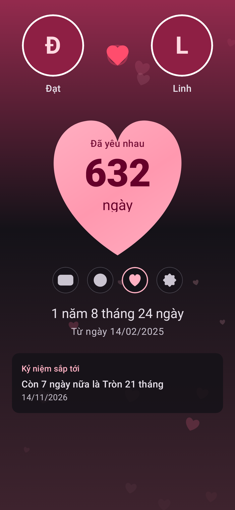
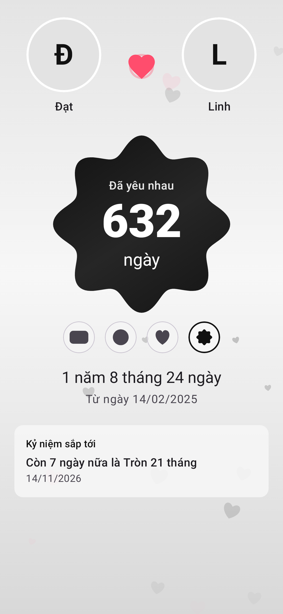

<div align="center">

# 💕 Đếm Ngày Yêu

**Ứng dụng Android đếm ngày yêu nhau, nhắc ngày kỷ niệm và hiển thị bộ đếm ngay trên màn hình chính.**


</div>

---

## Giới thiệu

**Đếm Ngày Yêu** giúp các cặp đôi lưu giữ hành trình bên nhau: bao nhiêu ngày đã yêu, khi nào tới 100 ngày, tròn tháng hay kỷ niệm năm, và không bao giờ quên sinh nhật người ấy. Ứng dụng hoạt động **hoàn toàn offline**, không cần tài khoản, mọi dữ liệu chỉ nằm trên điện thoại của bạn.

## Ảnh màn hình

| Bộ đếm | Kỷ niệm | Cài đặt |
|:---:|:---:|:---:|
|  |  |  |
| **Trái tim, giao diện tối** | **Bông hoa, màu đen** | **Thiết lập lần đầu** |
|  |  |  |

## Tính năng

### Bộ đếm ngày
- Số ngày yêu nổi bật, kèm dạng **"X năm Y tháng Z ngày"** và ngày bắt đầu.
- Chạm để đổi đơn vị: **ngày → tuần → tháng → giờ**, số chạy dần khi thay đổi.
- Chọn hình dạng khung ngay trên màn hình chính: **bo góc, hình tròn, trái tim, bông hoa**.
- Tuỳ chọn *"Tính ngày bắt đầu là ngày 1"* theo thói quen người Việt.
- Tự cập nhật khi qua 0h, khi đổi giờ hoặc múi giờ.

### Ngày kỷ niệm
- Mốc tự động: **100, 200 … 1000 ngày**, sau đó mỗi 500 ngày; **tròn N tháng**; **kỷ niệm N năm** (29/02 được xử lý đúng ở năm không nhuận).
- Ngày đặc biệt của riêng bạn: sinh nhật, ngày gặp nhau, ngày cầu hôn… có emoji, lặp hằng năm và bật/tắt nhắc.
- Bộ lọc *Tất cả / Tự động / Của tôi*, mốc gần nhất được làm nổi bật kèm đếm ngược.

### Thông báo nhắc
- Nhắc vào giờ bạn chọn (mặc định 8:00): đúng ngày, trước 1 ngày, trước 7 ngày.
- Không bao giờ gửi trùng một thông báo.

### Widget màn hình chính
- **2x2**: số ngày yêu trong một ô vuông cân đối.
- **4x2**: ảnh và tên hai người cùng kỷ niệm sắp tới.

### Cá nhân hoá
- Ảnh đại diện cho từng người và **ảnh nền app** từ thư viện ảnh.
- Giao diện **Sáng / Tối / Theo hệ thống**.
- Màu chủ đạo: **hồng, đỏ, tím, xanh, trắng, đen** hoặc *Dynamic Color* theo hình nền (Android 12+).
- Hiệu ứng động: trái tim đập, trái tim bay lơ lửng, mưa tim vào ngày kỷ niệm. Tự tắt khi hệ thống bật *Giảm chuyển động*.
- Ngôn ngữ **Tiếng Việt / English**.

## Công nghệ

| Hạng mục | Thư viện |
|---|---|
| Ngôn ngữ | Kotlin 2.4 |
| Giao diện | Jetpack Compose, Material 3 |
| Kiến trúc | MVVM, một Activity, Navigation Compose (type-safe) |
| DI | Hilt |
| Dữ liệu | Room (ngày đặc biệt, lịch sử thông báo), DataStore (cài đặt) |
| Nền | WorkManager |
| Widget | Jetpack Glance |
| Ảnh | Coil 3, Photo Picker |
| Kiểm thử | JUnit, Turbine, Robolectric, Compose UI Test |

`minSdk 26` (Android 8.0) · `targetSdk 37` · AGP 9.5 · Gradle 9.9

## Cấu trúc mã nguồn

```
app/src/main/java/com/example/lovedays/
├── core/           Đồng hồ (ClockProvider), theme, ngôn ngữ
├── data/           DataStore, Room, lưu ảnh
├── domain/         DayCounter, MilestoneGenerator, ReminderPlanner (hàm thuần, dễ test)
├── notification/   Worker nhắc kỷ niệm, lên lịch, thông báo
├── widget/         Widget Glance
└── ui/             onboarding · home · milestones · settings · components
```

## Build và chạy

Yêu cầu: **Android Studio** bản mới (hoặc JDK 17+) và **Android SDK Platform 37**.

```bash
git clone <địa chỉ repo này>
cd love-days-counter

./gradlew assembleDebug      # app/build/outputs/apk/debug/app-debug.apk
./gradlew assembleRelease    # bản release đã bật R8
./gradlew installDebug       # cài lên điện thoại đang cắm USB
```

Hoặc mở thư mục bằng Android Studio rồi bấm **Run ▶**.

> Bản release hiện ký bằng debug key để cài thử. Trước khi phát hành lên Google Play, hãy tạo keystore riêng, khai báo trong `signingConfigs` và đổi `applicationId`.

## Kiểm thử

```bash
./gradlew lint testDebugUnitTest
```

Bộ test gồm logic đếm ngày và sinh mốc kỷ niệm (năm nhuận, 29/02, cuối tháng, tuỳ chọn ngày 1), lập lịch nhắc, Room, DataStore, worker thông báo và giao diện Compose. Các test chạy trên JVM bằng Robolectric nên không cần máy ảo.

## Tác giả

**Vũ Đình Đạt**
