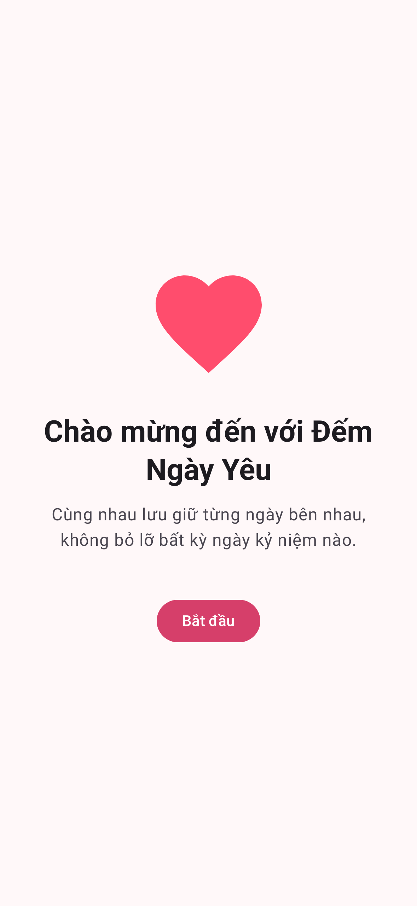
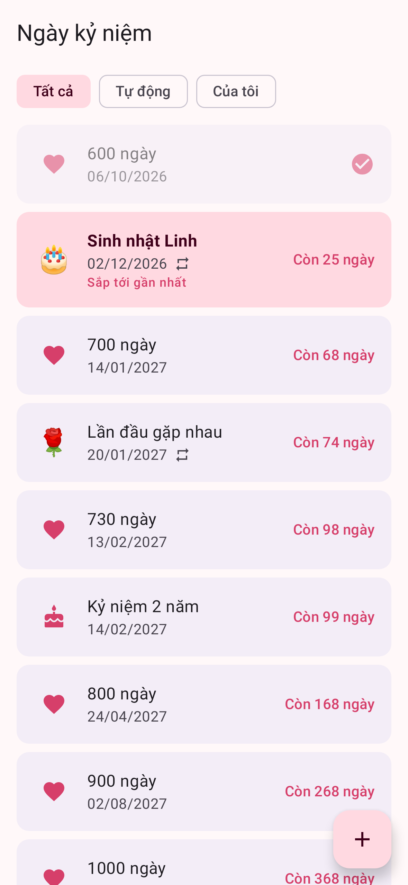
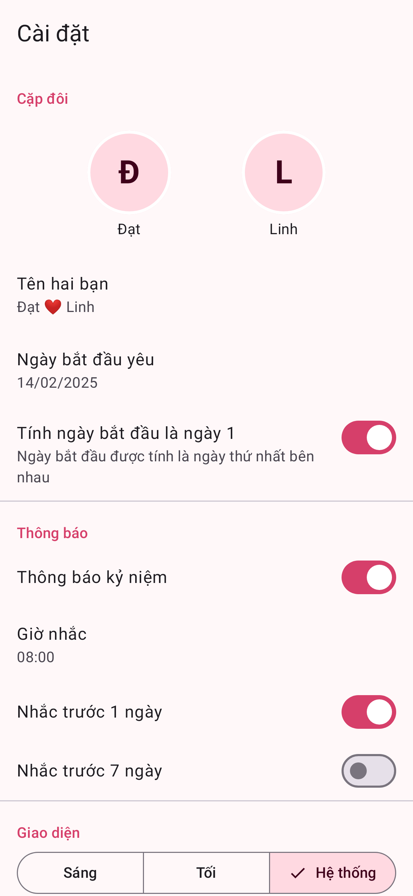

# Đếm Ngày Yêu (Love Days Counter)

Ứng dụng Android giúp cặp đôi đếm số ngày yêu nhau, nhắc các ngày kỷ niệm và hiển thị bộ đếm ngay trên màn hình chính bằng widget. Hoạt động hoàn toàn offline, dữ liệu chỉ lưu trên máy.

| Chào mừng | Bộ đếm | Kỷ niệm | Cài đặt |
|---|---|---|---|
|  |  |  |  |

## Tính năng (MVP)

- **F1 Thiết lập lần đầu:** tên hai người (1–30 ký tự), ngày bắt đầu (không chọn được ngày tương lai), ảnh đại diện (tuỳ chọn, Photo Picker, ảnh được copy và nén vào bộ nhớ trong), xin quyền thông báo có giải thích.
- **F2 Bộ đếm:** số ngày lớn, "X năm Y tháng Z ngày", ngày bắt đầu `dd/MM/yyyy`, kỷ niệm sắp tới. Chạm vào bộ đếm để đổi ngày → tuần → tháng → giờ. Tự cập nhật khi qua 0h, khi đổi giờ/múi giờ và khi quay lại app. Tuỳ chọn "Tính ngày bắt đầu là ngày 1" (mặc định bật).
- **F3 Mốc tự động:** 100…1000 ngày (mỗi 100), sau đó mỗi 500 ngày, 365 × n ngày, và tròn N năm (29/02 thành 28/02 ở năm không nhuận).
- **F4 Ngày đặc biệt:** thêm / sửa / xoá (có xác nhận), lặp hằng năm, emoji, bật/tắt nhắc. Bộ lọc Tất cả / Tự động / Của tôi.
- **F5 Thông báo:** WorkManager chạy 1 lần/ngày vào giờ nhắc (mặc định 8:00), nhắc đúng ngày, trước 1 ngày, trước 7 ngày; bảng `notification_log` chống gửi trùng.
- **F6 Widget (Glance):** 2x2 (số ngày) và 4x2 (ảnh, tên, mốc sắp tới). Cập nhật ngay khi dữ liệu đổi, sau 0h mỗi ngày, khi đổi giờ/múi giờ/ngôn ngữ.
- **F7 Cài đặt:** sửa tên, ảnh, ngày bắt đầu; tuỳ chọn ngày 1; thông báo (bật/tắt, giờ, trước 1 ngày, trước 7 ngày); giao diện Sáng/Tối/Hệ thống; màu Hồng/Đỏ/Tím/Xanh/Dynamic Color; ngôn ngữ Tiếng Việt/English (per-app language); xoá toàn bộ dữ liệu (xác nhận 2 bước).

## Công nghệ

Kotlin 2.4, Jetpack Compose + Material 3, MVVM, Hilt, Navigation Compose (type-safe), Room, DataStore, WorkManager, Glance, Coil 3, `java.time` (core library desugaring). `minSdk 26`, `compileSdk`/`targetSdk 37`, AGP 9.5, Gradle 9.9, Version Catalog (`gradle/libs.versions.toml`).

```
app/src/main/java/com/example/lovedays/
├─ core/        ClockProvider, TodayProvider, theme, ngôn ngữ
├─ data/        DataStore (SettingsRepository), Room, ImageStorage
├─ domain/      DayCounter, MilestoneGenerator, ReminderPlanner (hàm thuần)
├─ notification/ AnniversaryWorker, ReminderScheduler, NotificationHelper
├─ widget/      LoveDaysWidget (Glance) và receiver
└─ ui/          onboarding, home, milestones, settings, navigation
```

## Build và chạy

Yêu cầu JDK 17+ (Android Studio mới nhất đã có sẵn) và Android SDK Platform 37.

```bash
./gradlew assembleDebug          # APK debug: app/build/outputs/apk/debug/app-debug.apk
./gradlew assembleRelease        # APK release đã bật R8/minify
./gradlew installDebug           # cài lên máy đang cắm USB
```

Hoặc mở thư mục này bằng Android Studio rồi bấm Run.

> Bản release đang được ký bằng debug key để cài thử. Trước khi phát hành lên Google Play, hãy tạo keystore riêng và cấu hình `signingConfigs` trong `app/build.gradle.kts`. Nên đổi `applicationId` (`com.example.lovedays`) thành tên miền của bạn.

## Kiểm thử

```bash
./gradlew lint testDebugUnitTest
```

Gồm: unit test `DayCounter`, `MilestoneGenerator`, `ReminderPlanner`; Room in-memory (CRUD, chống trùng log); DataStore; `AnniversaryWorker` với `TestListenableWorkerBuilder`; Compose UI test (onboarding khoá nút Tiếp tục, Home hiển thị đúng số ngày với `ClockProvider` giả). Các test Android chạy bằng Robolectric nên không cần máy ảo. `ScreenshotTest` tạo ảnh màn hình vào `app/build/screenshots`.

## Thay đổi schema Room

`AppDatabase` đang ở version 1, schema xuất ra `app/schemas`. Khi đổi schema: tăng `version`, viết `Migration` và thêm vào `Room.databaseBuilder(...).addMigrations(...)` trong `di/AppModule.kt`.
